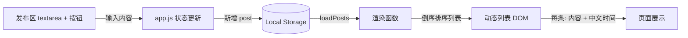

## 产品概述
一个最小可用的微博/推特类单页应用，使用纯 HTML、CSS 和 JavaScript 实现，零外部依赖（无框架、无库、无 CDN），通过浏览器直接打开即可使用。

## 核心功能
- **发布区**：提供文本输入框与“发布”按钮，用户输入内容后点击按钮即可发布新动态；空内容不可发布（输入校验），发布后清空输入框。
- **动态列表**：按发布时间倒序展示所有动态，每条动态显示其内容与发布时间（中文时间格式，如“2026年11月13日 14:30”）。
- **本地持久化**：基于 Local Storage 保存动态数据，刷新页面或重新打开浏览器后已发布内容仍然可见。
- **界面规范**：界面简洁美观、中文界面、可正常操作；不出现微博或其他社交软件的 logo / 商标，使用自创中性名称与原创图标（纯 CSS/SVG 简单图形）。

## 版本管理
- 使用 Git 进行本地版本管理（init、.gitignore、首次提交）。
- 先完成本地提交；推送到 GitHub 远程仓库的步骤留待用户补充仓库地址后再执行（执行时向用户询问仓库 URL）。


## 技术栈
- **前端**：原生 HTML5 + CSS3 + JavaScript（ES6+），单页应用，零外部依赖
- **数据持久化**：浏览器 Local Storage（key 如 `mini-feed-posts`，JSON 数组存储）
- **版本管理**：Git 本地仓库 + 后续推送 GitHub

## 实现方案
### 整体策略
采用“三文件分离”的标准静态站点结构（index.html / css/style.css / js/app.js），关注点分离清晰且符合最小项目规模，避免过度设计。

### 关键技术决策
1. **数据模型**：每条动态为 `{ id: string, content: string, createdAt: number(时间戳) }`，id 使用 `Date.now() + 随机数` 生成；时间戳便于倒序排序与灵活格式化。
2. **存储读写**：封装 `loadPosts()` / `savePosts()` 两个函数统一访问 Local Storage，读写均做 try/catch 与 JSON 解析容错（localStorage 损坏时回退为空数组），保证健壮性。
3. **渲染策略**：每次发布后整列表重渲染（数据量小，O(n) 渲染可接受）；排序在渲染前用 `sort((a,b) => b.createdAt - a.createdAt)` 完成倒序。
4. **安全细节**：动态内容使用 `textContent` / `createTextNode` 插入 DOM，避免 `innerHTML` 拼接用户输入，防止 XSS。
5. **时间格式化**：用原生 `Intl.DateTimeFormat('zh-CN')` 或手写格式化函数输出中文时间。
6. **交互细节**：textarea 支持 Ctrl/Cmd+Enter 快捷发布；空内容（含纯空格）禁用发布按钮并给出提示。

### 性能与可靠性
- 数据量小（本地个人使用），整表重渲染无性能瓶颈；存储写入仅在发布时触发一次。
- Local Storage 不可用（隐私模式等）时降级为仅内存展示，页面不报错。

### 架构设计


### 目录结构
```
d:/plan mode homework/
├── index.html        # [NEW] 页面结构：头部（自创应用名）、发布区、动态列表容器
├── css/
│   └── style.css     # [NEW] 简洁现代样式：居中卡片布局、发布区、动态卡片、时间样式
├── js/
│   └── app.js        # [NEW] 核心逻辑：loadPosts/savePosts、发布、倒序渲染、时间格式化
├── .gitignore        # [NEW] 忽略系统/编辑器杂项文件
└── README.md         # [NEW] 项目简介、功能说明、如何打开使用
```


## 设计风格
简洁现代的浅色卡片式风格，强调内容本身，整体干净清爽，适合动态流阅读。页面为单栏居中布局（最大宽度约 600px），顶部为应用标题栏（自创中性名称如“随记广场”，原创纯文字/简单图形，不含任何社交平台 logo），下方为发布区卡片，再下方为动态流。

### 页面结构（单页 4 个区块）
1. **顶部标题栏**：应用名 + 简短副标题（如“记录你的每一刻”），浅色背景，底部细分隔线。
2. **发布区卡片**：白色圆角卡片带柔和阴影，内含多行 textarea（占位文字“分享新鲜事…”）与右下角“发布”按钮（主色圆角按钮，hover 加深，禁用态灰化）；输入时按钮实时启用/禁用。
3. **动态列表**：垂直排列的白色卡片，每条含动态正文（较大字号、深色文字）与底部发布时间（小字号、灰色）；新发布的动态插入列表顶部，可加轻微淡入动画。
4. **空状态提示**：列表为空时显示居中的浅灰提示文案（如“还没有内容，快去发布第一条吧”）。

### 交互与响应
- 卡片 hover 时阴影轻微加深；按钮有 hover/active 过渡效果（约 0.2s）。
- 响应式：移动端下卡片边距收窄，按钮保持可点区域大小。

## Agent Extensions
### Skill
- **playwright-cli**
  - Purpose: 在实现完成后自动打开页面、执行发布操作、验证动态列表倒序展示与刷新后数据持久化是否正常
  - Expected outcome: 浏览器验证截图/结果证明发布、倒序展示、Local Storage 持久化三项核心功能均可用
